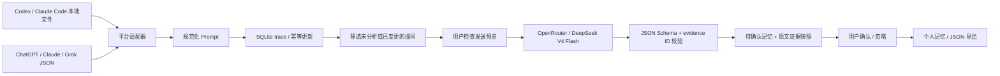

# 产品与 Agent 设计

## 产品边界

Tracelet 是独立于模型平台的个人记忆层，而不是另一款聊天工具。首版闭环为采集 → trace → 增量分析 → 候选记忆 → 用户确认 → 导出。优先做真实、本地、可审查的采集，后续通过只读 MCP 提供已确认记忆。未实现的路线图不在界面冒充可用功能。

## 数据流

## 采集与 trace

- 不从 macOS Accessibility 获取整屏文本，也不截获键盘。平台原生结构化日志能提供更稳定的对话与消息身份。未来网页接入应做显式授权的浏览器扩展，通过内容脚本获取已提交用户消息；每个平台需要专门适配、测试和域名授权，避免泛化抓取整个网页。
- 目录监听通过 chokidar，等待文件写入稳定后读取。不存在的来源目录可在后续创建；不跟随符号链接。单文件限制 100 MB。当前读取整个变更文件；大规模使用可升级为 byte-offset 增量 tail，记录 inode/mtime/offset 并处理 truncate/rotation。
- Prompt 字段：`id / provider / conversationId / conversationTitle / text / timestamp / source`。本地路径仅留在本机。
- 稳定 ID 为 SHA-256(platform + conversation ID + native message ID)。没有原生 ID 时，用用户消息序号；缺少 conversation ID 时退到来源路径摘要。原生 ID 存在时，跨文件拷贝也能去重。
- 不以正文 hash 直接去重：同一句“继续”可以是用户真实发出的不同消息，必须保留。已有消息文本变化时 upsert 更新；新增消息追加。SQLite 主键和事务保证幂等。
- Codex 同时有 response_item 和 event_msg 表示时优先 response_item，避免双写；识别并过滤启动上下文。Claude 排除工具返回和 meta 消息。只持久化用户文本，不持久化助手回答。
- JSONL 最后一行无效且没有换行时视作半条记录；中间行或已换行的无效 JSON 报错，保留上次成功同步内容。
- 没有原生 ID 的导出若重排或删除历史消息，序号可能变化；这是一项已知限制。首版不推断来源删除等同于用户要求删除个人记忆。

## 分析 Agent：受约束提炼器

首版使用单一受约束提炼器。独立的角色代理会增加隐私传播、费用及不可解释状态，目前没有必要。职责通过确定性步骤分开：

1. **调度**：从所选 trace 取新增或正文发生变化的提问。`analyzed` 表记录成功分析的正文摘要；失败不推进状态。每批 100 条 / 40,000 字符。没有后台自动付费调用。
2. **发送授权**：预览显示实际发送的提问正文、ID、模型及字符数。digest 绑定正文和模型；确认后若内容变化，拒绝发送并要求重开预览。API Key 只存在 main 进程，renderer 只能写入/移除或读取“已配置”状态。
3. **提炼**：固定 system 指令把输入声明为不可信的引用数据；不执行输入指令，没有工具、搜索、文件或命令执行能力。仅发送 `{id,text}`，不发送文件路径。OpenRouter 使用 HTTPS、120 秒超时、最大输出 token 限制，无自动重试或隐式模型回退。
4. **三类候选**：identity（明确自述），preferences（表达/交流偏好），needs（目标、要求、约束）。不从“问了某事”推断“就是某种人”；不提炼密钥、敏感属性或疾病诊断。模型仍可能违反要求，因此用户审阅是必需步骤。
5. **结构校验**：Zod 校验分类、正文长度、证据非空、置信度范围与候选数量。所有 evidence ID 必须来自本批，否则整批拒绝保存。存储当时证据正文的快照，后续编辑不会改变历史证据。
6. **记忆审阅**：每条为 pending，由用户接受为 accepted 或忽略为 rejected。完全相同的 claim 不重复新增。语义相近、时间冲突的记忆保留为独立候选，不自动合并或覆盖。自评 confidence 只是模型自评，不代表校准后的概率。

跨批去重目前是严格文本一致性；同义表述仍可能出现。要做长期高质量记忆，下一阶段应加入 `valid_from / valid_to / explicitly_stated / evidence_count / conflict_group`，用第二个受约束的比较请求提出 merge/supersede 建议，再由人确认。

## 安全与数据控制

- Electron main 负责文件、数据库和 API；sandbox renderer + contextIsolation，禁用 Node 集成。preload 只暴露类型化窄接口，不暴露原始 ipcRenderer。
- IPC 绑定当前应用窗口；禁止新窗口与页面跳转。CSP 限制脚本及网络。renderer 无直接 OpenRouter 网络访问。
- API Key 由 safeStorage 加密后写入 0600 文件；macOS 由 Keychain 保护。数据库原文没有额外加密，目录 0700、数据库 0600，建议 FileVault。威胁模型不覆盖已控制当前用户会话的恶意进程。
- 没有遥测和 Tracelet 后端；只有用户触发的模型列表查询与经预览同意的 AI 请求。AI 服务商可接触发送的原文，不能宣称完全离线或端到端加密。
- 删除本地数据先暂停采集、关闭 watcher 并排空正在执行的入库任务，再清空并 VACUUM；不删除平台日志、外部导出或备份，不撤回服务商已处理的数据。Key 另行移除。

## 技术选择与演进

Electron + React 适合当前 Linux 开发 / Mac runner 打包流程。sql.js 使解析和持久化测试不依赖原生 ABI，采用单进程写入和串行原子替换数据库文件。代价是整库在内存，每次持久化导出整库；大量长期数据应迁移至原生 SQLite WAL、分页查询与 FTS5，需保留迁移备份并验证 ABI。

阶段二：浏览器扩展、原生 SQLite 和全文检索、按敏感内容筛选/遮蔽后授权、冲突审阅、只读 MCP、代码签名/公证与更新签名。阶段三：跨设备加密同步，需要独立的密钥恢复和权限设计；不会将“同步”等同于云端明文上传。
